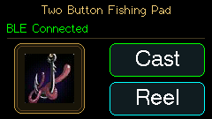
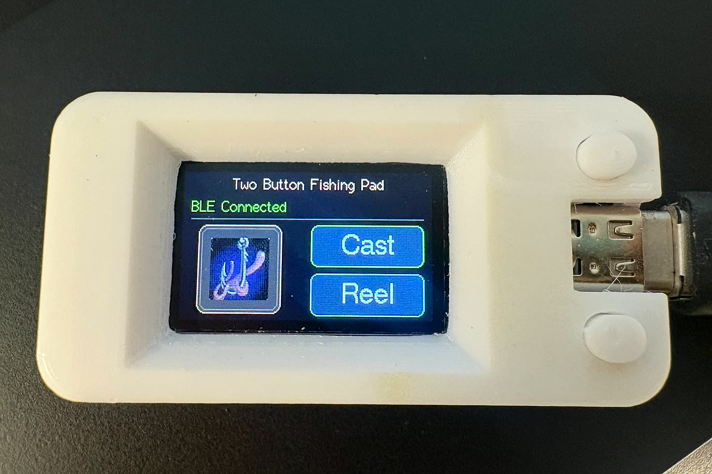
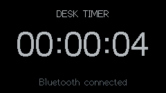

# ESP32 Fishing

A pocket-sized, two-button Bluetooth fishing controller for World of Warcraft.
Cast your line with one button and reel/interact with the other. Each press is
sent directly as a controller input—there is no bite detection or automatic fishing.





## Hardware

Tested on the **original LilyGO / TTGO T-Display v1.1**: ESP32, 135×240 ST7789 LCD,
and two onboard buttons. No extra wiring needed. The T-Display **S3 is not a
drop-in replacement**; other ESP32 boards need compatible display/pin settings.

Confirmed working with an **iPhone 16 and GeForce NOW**. Pair as
**Xbox Wireless Controller**, then configure your game's fishing bindings:

| Onscreen action | Physical button | Controller input |
| --- | --- | --- |
| Cast (top) | GPIO 35 | D-pad Left |
| Reel (bottom) | GPIO 0 | Xbox X |

The display shows BLE status and highlights held buttons.

**Press both buttons together** to switch between the fishing UI and an understated
**desk timer**. The timer shows elapsed time since power-on, not wall-clock time.
Single-button controls keep working in either mode. The combined press is consumed
locally. The selected display mode is remembered across restarts.



## Change the controls

Edit the constants near the top of [TwoButtonPad.ino](TwoButtonPad/TwoButtonPad.ino):

```cpp
constexpr uint8_t REEL_BUTTON = BUTTON_3;  // X; 1=A, 2=B, 4=Y
constexpr int8_t CAST_DIRECTION = HAT_LEFT; // HAT_UP / DOWN / RIGHT also work
```

Change `xButton{0}` / `leftButton{35}` for different GPIOs. Edit the `Cast` / `Reel`
strings in the drawing functions to rename the labels. Rebuild and flash afterward.
Do not hold GPIO 0 while powering on: it also selects the ESP32 bootloader.

## Build and flash

Requires Arduino CLI, **esp32:esp32 3.3.10**, and **M5GFX 0.2.19**.
NimBLE and the patched ESP32-BLE-Gamepad library are included under `libraries/`;
see [DEPENDENCIES.txt](DEPENDENCIES.txt) for pinned versions and patches.

```sh
arduino-cli core update-index --additional-urls \
  https://espressif.github.io/arduino-esp32/package_esp32_index.json
arduino-cli core install esp32:esp32@3.3.10 --additional-urls \
  https://espressif.github.io/arduino-esp32/package_esp32_index.json
arduino-cli lib install M5GFX@0.2.19
./build.sh
arduino-cli board list
arduino-cli upload --fqbn esp32:esp32:lilygo_t_display \
  --port /dev/ttyACM0 --input-dir build TwoButtonPad
```

Replace `/dev/ttyACM0` with the port shown by `arduino-cli board list`.

Full-brightness backlight; BLE battery percentage is a fixed placeholder, not a
battery measurement.

## Credits

The WoW Fishing icon belongs to Blizzard Entertainment; see
[asset attribution](assets/ATTRIBUTION.md). Third-party libraries retain their
included licenses. This project is not affiliated with Blizzard or Microsoft.

## License

Project code is licensed under the [MIT License](LICENSE), copyright 2026 Lanjelin.
Third-party libraries and the WoW icon retain their respective licenses and rights.
