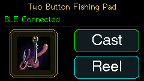
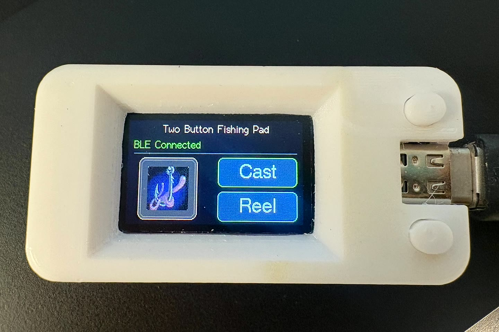
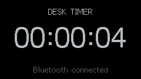

# ESP32 Fishing

A pocket-sized, two-button Bluetooth fishing controller for World of Warcraft.
Cast your line with one button and reel/interact with the other. Button presses
are sent as standard controller inputs.





## Hardware

Tested on the **original LilyGO / TTGO T-Display v1.1**: ESP32, 135×240 ST7789 LCD,
and two onboard buttons. No extra wiring needed. The T-Display **S3 is not a
drop-in replacement**; other ESP32 boards need compatible display/pin settings.

Confirmed working with an **iPhone 16 and GeForce NOW**. Pair as
**Desk Timer**, then configure your game's fishing bindings. Games may still
identify it as an XInput controller.

| Onscreen action | Default physical button | Controller input |
| --- | --- | --- |
| Cast (top) | GPIO 35 | D-pad Left |
| Reel (bottom) | GPIO 0 | Xbox X |

The display shows BLE status and highlights held buttons.

### Flip the screen

**Hold Reel alone for two seconds** to rotate the display 180 degrees. The
orientation is remembered across restarts. Button roles swap with the display,
so **Cast stays on top and Reel stays on the bottom** in either orientation.
The long hold only flips the screen; it does not send a Reel press.

### Controller mode

This uses WoW's built-in controller support. With Soft Targeting on, the game itself
targets the fishing bobber when it lands, so the Reel button is just the normal Interact
input. In controller mode, the game handles bobber targeting and interaction.

Controller mode must be enabled in the game's settings first, if it isn't already. See
[Playing WoW with a controller](https://www.icy-veins.com/wow-forever/playing-with-controller)
for setup.

**Press both buttons together** to switch between the fishing UI and an understated
**desk timer**. The timer shows elapsed time since power-on, not wall-clock time.
Single-button controls keep working in either mode. The combined press is consumed
locally. The selected display mode is remembered across restarts.



### Controller connected, but not working in-game?

On iPhone with GeForce NOW in Safari or its Home Screen web app (PWA):

1. Open the [gamepad tester](https://hardwaretester.com/gamepad) in Safari on the
   same phone. Press Cast and Reel and check that the tester registers both inputs.
   If neither registers, check the Bluetooth connection before troubleshooting the game.
2. If the tester works, return to the game, tap the stream, and try the buttons
   again. Check that controller support and the fishing bindings are enabled in-game.
3. Close and reopen GeForce NOW with the controller already connected.
4. If input still works in the tester but not in GeForce NOW, remove the GeForce
   NOW web app from the Home Screen. Open GeForce NOW in Safari, use **Share → Add
   to Home Screen** to set it up again, then launch it and sign in as needed.

## Change the controls

GPIOs are defined by `gpio0Button` / `gpio35Button` in
[TwoButtonPad.ino](TwoButtonPad/TwoButtonPad.ino). The `castButton()` / `reelButton()`
helpers apply the orientation-aware roles. Controller report mappings are in
`FishingPad::send()` in [DualBluetooth.h](TwoButtonPad/DualBluetooth.h).
Edit the `Cast` / `Reel`
strings in the drawing functions to rename the labels. Rebuild and flash afterward.
Do not hold GPIO 0 while powering on: it also selects the ESP32 bootloader.

## Install without building

The easiest way, on **Windows, macOS and Linux**, needs no tools or compiling.
A ready-made firmware is in [`docs/firmware/`](docs/firmware/TwoButtonPad-t-display-v1.1.bin)
(checksum in [`SHA256SUMS`](docs/firmware/SHA256SUMS)).

### Browser flasher (recommended)

1. Open the **[web flasher](https://lanjelin.github.io/esp32-fishing/)** in **Chrome or
   Edge** on a computer. Firefox and Safari cannot flash devices.
2. Plug the T-Display into the computer with a USB **data** cable.
3. Click **Install**, pick the board's serial port (e.g. *USB Serial*, *CP210x* or
   *CH340*, or `COMx` on Windows), and confirm. It takes about a minute.
4. Pair the pad with your phone as **Desk Timer**.

The page uses [ESP Web Tools](https://esphome.github.io/esp-web-tools/): the firmware is
sent from your browser straight to the board over USB, and nothing is installed.
The bundled firmware is a **full-flash image**: installing it resets saved
Bluetooth pairings and display preferences, even if **Erase device** is unchecked.
Remove the old phone pairing and pair **Desk Timer** again after updating.
The **Erase device** checkbox additionally offers a complete flash erase for a
clean installation.

**No serial port listed?**

- Try another cable; many are charge-only.
- **Windows:** install the USB driver for your board's chip, either
  [CP210x](https://www.silabs.com/developer-tools/usb-to-uart-bridge-vcp-drivers) or
  [CH340/CH9102](https://www.wch-ic.com/downloads/CH341SER_EXE.html). Windows 10 and 11
  often install it automatically.
- **Linux:** add yourself to the serial group (`dialout` on Debian/Ubuntu/Fedora,
  `uucp` on Arch), then log out and in again.
- If connecting fails, hold the GPIO 0 / BOOT button while plugging the board in, click
  **Install** again, and release once flashing starts.

### Command line

With [esptool](https://github.com/espressif/esptool) (`pip install esptool`):

```sh
esptool --chip esp32 --port /dev/ttyACM0 write-flash 0x0 \
  docs/firmware/TwoButtonPad-t-display-v1.1.bin
```

Use `COM3` or similar on Windows. The firmware targets the original T-Display v1.1 only.

## Build from source

Requires Arduino CLI, **esp32:esp32 3.3.10**, and **M5GFX 0.2.19**.
The controller descriptor and its third-party license are included under
`libraries/`; see [DEPENDENCIES.txt](DEPENDENCIES.txt) for pinned versions and patches.

```sh
arduino-cli core update-index --additional-urls \
  https://espressif.github.io/arduino-esp32/package_esp32_index.json
arduino-cli core install esp32:esp32@3.3.10 --additional-urls \
  https://espressif.github.io/arduino-esp32/package_esp32_index.json
arduino-cli lib install M5GFX@0.2.19
./build.sh
arduino-cli board list
arduino-cli upload --fqbn esp32:esp32:lilygo_t_display \
  --port /dev/ttyACM0 --input-dir build TwoButtonPad
```

Replace `/dev/ttyACM0` with the port shown by `arduino-cli board list`.

Full-brightness backlight; BLE battery percentage is a fixed placeholder, not a
battery measurement.

## Credits

The WoW Fishing icon belongs to Blizzard Entertainment; see
[asset attribution](assets/ATTRIBUTION.md). Third-party libraries retain their
included licenses. This project is not affiliated with Blizzard or Microsoft.

## License

Project code is licensed under the [MIT License](LICENSE), copyright 2026 Lanjelin.
Third-party libraries and the WoW icon retain their respective licenses and rights.
